# Documentation technique : AlphaForge AI, le Tribunal des décisions d'investissement

Ce document décrit **comment** le système fonctionne et **comment le vérifier**. Il ne recopie pas les sources : il y renvoie.

| Pour… | Lire |
|---|---|
| Les règles du projet et le contrat JSON complet | [`CLAUDE.md`](../CLAUDE.md) |
| Le **pourquoi** de chaque choix d'architecture | [`CHOIX_CONCEPTION.md`](CHOIX_CONCEPTION.md) |
| Le schéma AWS détaillé | [`architecture.md`](architecture.md) |
| Ce qui a été construit, issue par issue | [`journal/`](journal/) |
| Une explication sans jargon | [`GUIDE_DU_PROJET.md`](GUIDE_DU_PROJET.md) |
| **Chaque écran du prototype**, en captures (le jury ne pourra pas le tester) | [section 11](#11-le-prototype-en-captures) et [`preuves/ecrans/`](preuves/ecrans/README.md) |

> Simulation éducative. Aucune transaction réelle. Ceci n'est pas un conseil financier personnalisé.

**Règle de ce document** : chaque chiffre cité renvoie au fichier du dépôt d'où il vient.

---

## 1. Le principe : un procès, pas une recommandation

L'utilisateur arrive avec **sa propre décision** (« 25 % de mon portefeuille en Tesla »). Le système ne propose rien : il fait le **procès** de cette décision contre le **Pacte** de l'investisseur, c'est-à-dire ses règles déclarées à l'avance. L'utilisateur rend le verdict. Pourquoi ce cadrage : [`CHOIX_CONCEPTION.md`](CHOIX_CONCEPTION.md), choix 1 et 8.

Une seule règle traverse tout le code : **Python calcule, le LLM explique** ([choix 2](CHOIX_CONCEPTION.md), [`CLAUDE.md`](../CLAUDE.md) section 2). Aucun nombre n'est produit par un modèle de langage ; chaque nombre affiché vient d'une fonction Python testée.

## 2. Les agents et leur rôle

> **À l'écran** : [le procès de Robert, 30 % en TSLA](preuves/ecrans/05-robert-tribunal.png) : bilan du Greffier, débat question par question, répliques, instruction par l'orchestrateur, argument renvoyé par le Greffier, contre-interrogatoire.

Les phases sont **fixes** : Profil → Orchestrateur → Procureur et Avocat → Réplique → Greffier → Verdict. Elles sont enchaînées par `juger_decision` ([`pipeline/tribunal.py`](../pipeline/tribunal.py)).

| Phase | Qui | LLM ? | Rôle | Code | Fiche |
|---|---|---|---|---|---|
| 0 | Pacte vécu, questionnaire | Non | Seuil de pire baisse mesuré sur de vrais jours de marché ; réponses au questionnaire. Pièces `declaree`, vérifiées avant tout appel Bedrock | [`calibrage.py`](../pipeline/calibrage.py), [`questionnaire.py`](../pipeline/questionnaire.py) | [068](journal/068-pacte-vecu.md), [084](journal/084-questionnaire-investisseur.md) |
| 1 | **Agent Profil** | Oui | Charge et valide le Pacte, puis transforme la demande en décision structurée (`position` ou `reallocation`). Demande ambiguë → contrôle `interpretation_demande` à `a_verifier` | [`agent_profil.py`](../pipeline/agent_profil.py) | [008](journal/008-agent-profil.md) |
| 2 | **Orchestrateur** | Oui | Instruit le dossier : choisit les outils Python et leurs paramètres, avec une raison courte par appel. Chaque résultat devient une pièce numérotée | [`orchestrateur.py`](../pipeline/orchestrateur.py) | [012](journal/012-orchestrateur.md) |
| 3 | **Procureur** et **Avocat** | Oui, en parallèle | Argumentent contre et pour, en citant **uniquement** des pièces. Ne calculent rien, n'appellent aucun outil | [`debat.py`](../pipeline/debat.py) | [011](journal/011-procureur-avocat.md) |
| 3 bis | **Réplique** (Procureur et Avocat) | Oui, en parallèle | Chaque camp lit les arguments de l'autre que le Greffier accepte tels quels, et répond à celui qui pèse le plus contre lui, avec les mêmes pièces et les mêmes règles. Le Greffier vérifie les répliques comme les autres arguments (#189) | [`debat.py`](../pipeline/debat.py) (`repliquer_les_deux`) | [189](journal/189-agents-coordonnes.md) |
| 4 | **Greffier** | **Non** | Contrôle chaque règle du Pacte (`verifier_pacte`), chaque chiffre cité (`verifier_chiffres`) et l'absence de conseil ou de promesse (`cadre_simulation`). Un argument fautif est renvoyé une fois, puis rejeté | [`greffier.py`](../pipeline/greffier.py), [`chiffres.py`](../pipeline/chiffres.py), [`cadre_simulation.py`](../pipeline/cadre_simulation.py) | [010](journal/010-greffier.md), [060](journal/060-cadre-simulation.md) |
| 5 | **L'utilisateur** | — | Rend le verdict : `maintenu`, `modifie` ou `pacte_ajuste`. Archivé dans S3 ; il nourrit la jurisprudence des procès suivants | [`lambda_tribunal.py`](../deploiement/lambda_tribunal.py) (`/verdict`) | [056](journal/056-jurisprudence.md) |

Après le procès, l'utilisateur peut poser une question libre (**contre-interrogatoire**) : la même boucle orchestrateur → débat → Greffier, avec un budget de 4 appels (`BUDGET_APPELS_QUESTION`, [`orchestrateur.py`](../pipeline/orchestrateur.py)). Fiche [055](journal/055-contre-interrogatoire.md).

Le Greffier a remplacé l'ancien agent Gouvernance, et le débat a remplacé l'agent Explicabilité : [`CHOIX_CONCEPTION.md`](CHOIX_CONCEPTION.md), choix 5 et 6.

## 3. L'orchestrateur Bedrock et ses garde-fous

> **À l'écran** : l'encadré « Comment les agents ont instruit ce dossier » de [la capture du procès](preuves/ecrans/05-robert-tribunal.png) liste chaque outil choisi par l'orchestrateur, sa raison et la pièce produite ; [le procès en cours](preuves/ecrans/04-robert-proces-en-cours.png) montre les phases réelles, étape par étape.

L'orchestrateur est une boucle **Converse** de Bedrock avec `toolConfig` (*tool use*), codée dans [`pipeline/orchestrateur.py`](../pipeline/orchestrateur.py) et [`pipeline/llm.py`](../pipeline/llm.py) (`converser_avec_outils`). Le modèle **choisit** les preuves ; Python les **produit** et encadre le choix. Le service managé Bedrock Agents a été écarté : [`CHOIX_CONCEPTION.md`](CHOIX_CONCEPTION.md), choix 4.

| Garde-fou | Ce que fait Python | Où |
|---|---|---|
| **Liste blanche** | Seuls les outils de `outils_du_profil` sont décrits au modèle et exécutés : outils 1 à 4, jurisprudence, recherche documentaire, liquidité. Les outils du Greffier ne le sont jamais | `outils_du_profil` |
| **Budget** | `BUDGET_APPELS = 8` appels au plus, refus compris, puis passage au débat | ligne `BUDGET_APPELS` |
| **Raison obligatoire et sans chiffre** | Une phrase par appel ; un chiffre dans la raison fait refuser l'appel, et le modèle reçoit le motif | schéma du champ `raison` |
| **Pièce obligatoire** | Si le modèle n'a pas demandé la simulation complète de la décision, Python l'ajoute d'office et le note dans la trace | `instruire_dossier` |
| **Points de bascule** | Dès qu'une règle calculable est en violation, Python ajoute d'office la pièce `points_de_bascule` avant le débat | [`points_de_bascule.py`](../pipeline/points_de_bascule.py), fiche [061](journal/061-points-de-bascule.md) |
| **Erreur d'outil** | Titre hors univers, taille impossible… : renvoyée au modèle comme résultat en erreur, sans pièce | trace : `sortie` = « Erreur : … » |
| **Phases fixes** | L'orchestrateur choisit les outils, jamais l'ordre des phases ni le verdict. Le Greffier passe toujours en dernier | [`tribunal.py`](../pipeline/tribunal.py) |

| **Guardrail Bedrock** (#189) | La demande et la question de l'utilisateur sont soumises au Guardrail avant tout appel au modèle (attaque de consigne) ; chaque argument qui passe déjà les vérifications Python l'est aussi, en sortie (sujet refusé « conseil personnalisé »). Second regard, jamais à la place du Greffier | `verifier_garde_fou` ([`llm.py`](../pipeline/llm.py)), [fiche 186](journal/189-agents-coordonnes.md) |
| **Mesure** (#189) | Chaque étape de trace porte son heure ; le champ `bedrock` du contrat compte les appels par agent, les jetons, la durée et le coût estimé | `compter_appels` ([`llm.py`](../pipeline/llm.py)) |

Ces garde-fous sont **testés avec un faux modèle** : un modèle qui demande 10 outils n'en obtient que 8 ; un modèle qui oublie la simulation la voit ajoutée d'office ; un appel à `verifier_chiffres` est refusé ; une raison chiffrée est refusée ([`validation/resultats_scenarios.md`](validation/resultats_scenarios.md), section 6).

**Mesurés sur les vrais procès** (#167, [PR #175](https://github.com/yanisbenboudaoud/Datathon2026/pull/175), fichier `docs/validation/evaluation_orchestrateur.md`, lu le 2026-11-15) : sur 201 procès archivés dans S3, le budget de 8 appels est respecté 201 fois sur 201, et le modèle a demandé lui-même la simulation obligatoire dans 201 procès sur 201 (0 ajout d'office). Les outils changent avec le Pacte : `calculer_correlations` est demandé dans 30 procès sur 30 pour le profil audacieux contre 49 sur 126 pour le profil prudent, et `rechercher_documents` n'est demandé que pour le profil ESG. Limite écrite dans ce rapport : ces procès ne sont pas un échantillon planifié.

**Ce qui varie et ce qui ne varie jamais.** Le plan de procès du même rapport juge chaque décision deux fois pour chaque profil : l'orchestrateur choisit les mêmes outils dans 6 cas sur 9. C'est le comportement attendu d'un agent qui *choisit* ses preuves : à la marge, il peut ajouter la liquidité ou omettre les indicateurs du titre seul. Ce qui ne varie jamais est écrit en Python : l'ordre des phases, la simulation obligatoire, les points de bascule ajoutés d'office, le budget, chaque contrôle du Pacte et la vérification de chaque chiffre. Le verdict du Greffier sur le Pacte ne dépend donc pas du choix des outils ; seuls les arguments du débat en dépendent, et chacun reste vérifié.

## 4. Les outils, la méthode de calcul et les hypothèses

### Les outils (Python, sans LLM)

Liste complète, avec qui les appelle : [`CLAUDE.md`](../CLAUDE.md), section 4 bis. Résumé :

| Outil | Rôle | Code | Fiche |
|---|---|---|---|
| `charger_donnees` (socle) | Lit les CSV (local ou S3), convertit en CAD, aligne les calendriers | [`donnees.py`](../pipeline/donnees.py) | [004](journal/004-charger-donnees.md), [005](journal/005-conversion-cad.md) |
| 1 `indicateurs_actif` | Rendement annualisé, volatilité, pire baisse, rendement 2022, temps de récupération d'un titre | [`indicateurs.py`](../pipeline/indicateurs.py) | [006](journal/006-indicateurs-actif.md) |
| 2 `simuler_portefeuille` | Portefeuille avant et après la décision, rejeu de 2022, devise, pouvoir d'achat, frais | [`simulation.py`](../pipeline/simulation.py) | [009](journal/009-simuler-portefeuille.md) |
| 3 `calculer_correlations` | Corrélation entre titres | [`correlations.py`](../pipeline/correlations.py) | [016](journal/016-diversification.md) |
| 4 `taille_max_compatible` | Plus grande taille qui respecte toutes les règles calculables (pas de 1 point) | [`taille_max.py`](../pipeline/taille_max.py) | [021](journal/021-taille-max-compatible.md) |
| 5 `verifier_pacte` | Greffier : un contrôle par règle du Pacte | [`greffier.py`](../pipeline/greffier.py) | [010](journal/010-greffier.md) |
| 6 `verifier_chiffres` | Greffier : chaque nombre cité existe dans une pièce citée | [`chiffres.py`](../pipeline/chiffres.py) | [010](journal/010-greffier.md) |
| 7 `consulter_jurisprudence` | Verdicts passés du même profil | [`jurisprudence.py`](../pipeline/jurisprudence.py) | [056](journal/056-jurisprudence.md) |
| 8 `points_de_bascule` | La taille, ou le seuil, qui rendrait chaque règle conforme | [`points_de_bascule.py`](../pipeline/points_de_bascule.py) | [061](journal/061-points-de-bascule.md) |
| 9 `mesurer_liquidite` | Jours de bourse pour revendre chaque ligne | [`liquidite.py`](../pipeline/liquidite.py) | [117](journal/117-risque-de-liquidite.md) |
| `rechercher_documents` | Pièce `documentaire` ESG, ou « source manquante » | [`documents.py`](../pipeline/documents.py) | [017](journal/017-preferences-non-financieres.md) |

Chaque outil rend une **pièce** : `valeurs` brutes (au moins 4 décimales), `valeur_affichee` arrondie par Python, `source`, `traitement` et `limites` ([`CHOIX_CONCEPTION.md`](CHOIX_CONCEPTION.md), choix 3).

### Méthode de calcul

La méthode est fixée dans [`CLAUDE.md`](../CLAUDE.md), section 6 bis. En bref :

- **Prix** : `adj_close` (ajustés pour dividendes et fractionnements), convertis en CAD avec le taux USD/CAD de la Banque du Canada, dernier taux connu reporté.
- **Calendrier** : séances de la bourse américaine ; prix TSX et crypto reportés au dernier prix connu.
- **Rendement annualisé** composé ; **volatilité** = écart type quotidien × √252 ; **pire baisse** depuis un sommet ; **rendement 2022** de la dernière valeur de 2021 à la dernière de 2022 ; **temps de récupération** du sommet précédant la pire baisse au retour à ce sommet.
- **Portefeuille** : rééquilibrage quotidien aux poids cibles ; financement `proportionnel` ou `depuis_<ticker>`.
- **Plafonds par transparence** : un FNB compte pour sa part réelle d'une catégorie, selon sa composition publiée ([`composition.py`](../pipeline/composition.py), fiche [116](journal/116-composition-fnb.md)).
- **Pouvoir d'achat** : rendement réel par la relation de Fisher, IPC utilisé seulement s'il était publié à la date de la mesure ([`macro.py`](../pipeline/macro.py), fiche [113](journal/113-inflation-rendement-reel.md), [choix 16](CHOIX_CONCEPTION.md)).
- **Frais des FNB** : déjà prélevés dans `adj_close`, affichés sans être déduits une seconde fois (fiche [114](journal/114-frais-fnb.md)).

Pièges des données de départ et façon dont ils sont traités : [`CLAUDE.md`](../CLAUDE.md), section 6, et [`alphaforge_starter/README.md`](../alphaforge_starter/README.md).

### Hypothèses

Chaque contrat les énumère dans son champ `hypotheses`. Les principales :

- Période d'analyse : 2021-11-12 au 2026-11-12 ([`README.md`](../README.md), « Données »).
- Les **seuils des Pactes** sont des hypothèses de l'équipe, pas des recommandations réglementaires, sauf la pire baisse mesurée par le Pacte vécu ([`CLAUDE.md`](../CLAUDE.md), section 3).
- Le **budget** de 8 appels et le barème du questionnaire ([`config/questionnaire.json`](../config/questionnaire.json)) sont des hypothèses de l'équipe.
- L'IPC du mois M est supposé publié le dernier jour du mois M + 1 (`date_publication_ipc`, [`macro.py`](../pipeline/macro.py)).
- La composition des FNB, relevée en novembre 2026, s'applique à toute la période ([`composition_fnb.json`](../donnees_externes/composition_fnb.json)).

## 5. Le Pacte générique

> **À l'écran** : [le Pacte tiré du questionnaire](preuves/ecrans/16-construire-pacte-apercu.png), chaque règle avec la réponse qui l'a produite, et [la limite mesurée par le Pacte vécu](preuves/ecrans/18-pacte-vecu-resultat.png) sur de vrais jours de baisse.

Un profil est **un fichier JSON** dans [`personas/`](../personas/), validé par [`personas/schema_pacte.json`](../personas/schema_pacte.json) et chargé par `charger_pacte` ([`pipeline/pacte.py`](../pipeline/pacte.py)). Le code ne teste jamais un nom de persona : il lit les règles ([`CHOIX_CONCEPTION.md`](CHOIX_CONCEPTION.md), choix 7 et 7 bis ; fiche [003](journal/003-pacte-generique.md)).

| `type` de règle | Paramètres | Contrôle du Greffier |
|---|---|---|
| `pire_baisse_max` | `seuil` | `violation` si la pire baisse simulée après la décision est plus basse que le seuil |
| `plafond` | `categories`, `max` | `violation` si la part de ces catégories dépasse `max` ; `max: 0` = exclusion |
| `critere_documentaire` | `critere` | `violation` ou `conforme` selon une pièce documentaire ; `a_verifier` sans pièce |
| `qualitative` | aucun | toujours `a_verifier` : jugée par l'utilisateur |

Les **catégories** des plafonds sont définies une seule fois pour tous les profils dans [`config/categories.json`](../config/categories.json) : `crypto`, `tech`, `energie_fossile`, et les catégories géographiques `canada`, `etats_unis`, `hors_canada`. Chacune se définit par les champs `asset_class`, `sector` ou `market` de [`assets_universe.csv`](../alphaforge_starter/assets_universe.csv), plus des `ajouts` et des `retraits` justifiés. Un titre absent de l'univers n'est jamais classé au hasard : le contrôle rend `a_verifier` ([`pipeline/categories.py`](../pipeline/categories.py)).

Un profil peut avoir plusieurs **poches** (plusieurs horizons dans un même portefeuille) : [`pipeline/poches.py`](../pipeline/poches.py), fiche [115](journal/115-poches-horizons.md). Un Pacte peut aussi naître du **questionnaire investisseur**, transformé en fichier profil par Python sans LLM : fiche [084](journal/084-questionnaire-investisseur.md).

**Preuve que c'est générique** : un 4ᵉ profil inventé, écrit en un seul fichier JSON, est jugé sans aucune ligne de code ([`validation/resultats_scenarios.md`](validation/resultats_scenarios.md), section 7). Comment ajouter un profil : [`README.md`](../README.md), « Ajouter un profil ».

## 6. L'explicabilité : remonter d'un argument au fichier source

> **À l'écran** : [le tiroir d'une pièce](preuves/ecrans/07-robert-piece-simulation.png) (ce qu'elle montre, d'où viennent les données, données vérifiées, limites, étapes du calcul) et [le procès-verbal exporté](preuves/ecrans/09-robert-proces-verbal.png).

Chaque argument affiché cite des pièces ; chaque pièce nomme l'outil qui l'a produite, sa source, son traitement et ses limites ; chaque appel d'outil est dans la trace, avec la raison de l'orchestrateur ; le champ `sources` relie chaque fichier aux pièces qui l'utilisent ([`pipeline/sources.py`](../pipeline/sources.py), fiche [111](journal/111-diversite-des-sources.md)). Chaque élément porte une étiquette `fait`, `hypothese` ou `fictif` ([choix 9](CHOIX_CONCEPTION.md)).

### Exemple réel, remonté pas à pas

Procès réellement tenu par la Lambda le 2026-11-15 et archivé dans S3, copié tel quel : [`frontend/src/data/proces/2026-11-15-032ec3367b19.json`](../frontend/src/data/proces/2026-11-15-032ec3367b19.json). Profil de test prudent (`robert`, fictif), demande : « Je veux mettre 25 % de mon portefeuille en Tesla ».

**1. L'argument** (champ `requisitoire`, 2ᵉ argument du Procureur, étiquette `fait`) :

> « Cette position s'écarte de votre règle « Préserver mon capital » : TSLA a connu une chute de 70,9 % depuis un sommet et mis 2,9 ans à y revenir. » — pièces : `P4`

**2. La pièce citée** (champ `pieces`, `P4`) :

| Champ | Valeur |
|---|---|
| `outil` | `indicateurs_actif` |
| `titre` | Indicateurs de TSLA |
| `valeurs.pire_baisse` | `-0.708806` |
| `valeurs.annees_recuperation` | `2.921287` (sommet le `2022-01-03`, creux le `2023-01-03`, retour au sommet le `2024-12-05`) |
| `valeur_affichee` | « −70,9 % max · +5,5 %/an · 2,9 ans pour revenir au sommet » |
| `source` | « Yahoo Finance via yfinance (adj_close), extrait le 2026-11-13 ; USD/CAD Banque du Canada, extrait le 2026-11-13 » |
| `traitement` | Prix `adj_close` convertis en CAD, calendrier des séances américaines, pire baisse depuis un sommet, temps de récupération… |
| `limites` | « Une seule période de 5 ans ; une seule chute observée pour le temps de récupération ; biais du survivant ; le passé ne prédit pas l'avenir » |

Le Greffier a accepté les deux nombres : « 70,9 % » sans signe suit le mot « chute de », il est donc comparé à la valeur absolue de `-0.708806` arrondie à une décimale (règle 4 de la section 7 ci-dessous) ; « 2,9 » est `2.921287` arrondi à une décimale (règle 3).

**3. L'étape de la trace** (champ `trace`) : pourquoi cette pièce existe.

```json
{"etape": "orchestrateur", "outil": "indicateurs_actif",
 "raison": "Juger le risque propre du titre face à un horizon court et à l'objectif de préserver le capital.",
 "entree": {"ticker": "TSLA"}, "sortie": "P4"}
```

L'orchestrateur a choisi cet outil lui-même, à cause de l'horizon court (3 à 5 ans) et de la règle qualitative « Préserver mon capital » du Pacte ([`personas/robert.json`](../personas/robert.json)).

**4. Le fichier source** (champ `sources` du même contrat) : `P4` figure dans les pièces de deux sources :
- « Yahoo Finance via yfinance (prix ajustés) », fichier `prices_daily.csv` ([`alphaforge_starter/prices_daily.csv`](../alphaforge_starter/prices_daily.csv), colonne `adj_close`, lignes `TSLA`), extrait le 2026-11-13 ;
- « Banque du Canada, API Valet : change USD/CAD », fichier `fx_usdcad_daily.csv` ([`alphaforge_starter/fx_usdcad_daily.csv`](../alphaforge_starter/fx_usdcad_daily.csv)), car TSLA est cotée en USD ([`assets_universe.csv`](../alphaforge_starter/assets_universe.csv)).

**5. Refaire le calcul** : le chiffre se recalcule sans LLM, avec le même code.

```bash
python -c "from pipeline.indicateurs import indicateurs_actif as i; print(i('TSLA')['valeurs'])"
```

La chaîne complète est donc : argument → `P4` → `indicateurs_actif` → `prices_daily.csv` + `fx_usdcad_daily.csv`, avec la raison de l'orchestrateur dans la trace. L'interface montre la même chaîne (pièces cliquables, trace, sources), et le procès-verbal imprimable aussi ([`pipeline/proces_verbal.py`](../pipeline/proces_verbal.py), fiche [057](journal/057-proces-verbal.md)).

## 7. Les règles de `verifier_chiffres`

> **À l'écran** : l'encadré « Arguments contrôlés par le Greffier pendant ce procès » de [la capture du procès](preuves/ecrans/05-robert-tribunal.png) montre un vrai renvoi : chiffres fautifs, motif exact, version corrigée et acceptée.

Le vérificateur ([`pipeline/chiffres.py`](../pipeline/chiffres.py)) porte la promesse « aucun chiffre inventé ne passe ». Ses dix règles sont dans [`CLAUDE.md`](../CLAUDE.md), section 4 ter ; chaque exemple de cette section est un test unitaire ([`tests/test_chiffres.py`](../tests/test_chiffres.py)). En bref :

1. **Ce qui est vérifié** : chaque nombre du texte (pourcentages, décimaux, entiers, années, dates), sauf les identifiants de pièces et les nombres d'un nom d'actif (« S&P 500 »). La virgule n'est décimale que si un chiffre la suit.
2. **Contre quoi** : seulement les pièces **citées** par l'argument, plus la décision et la période d'analyse.
3. **Arrondi** : la valeur de la pièce est arrondie au nombre de décimales écrit dans le texte. Aucune tolérance pour « environ » ou « près de ».
4. **Signe** : un signe écrit doit correspondre ; sans signe, le nombre est positif, sauf après un mot de baisse (« chute de »).
5. **Dates** : elles doivent correspondre à une date ISO d'une pièce citée.
6. **Aucun nombre dérivé** : un écart ou un ratio doit exister tel quel dans une pièce, donc être calculé par Python.
7. **Plages et listes** : chaque nombre est vérifié séparément.
8. **Échec** : renvoyé **une fois** à son agent avec le motif exact, puis `arguments_rejetes` s'il échoue encore.
9. **Compte rendu** : « nombres vérifiés / nombres extraits » et nombre d'arguments.
10. **Tests obligatoires**.

Le même renvoi s'applique au cadre « simulation seulement » : aucun conseil ni promesse sur l'avenir ([`CLAUDE.md`](../CLAUDE.md), section 4 quater ; [`cadre_simulation.py`](../pipeline/cadre_simulation.py)).

### Exemple réel : un argument renvoyé puis corrigé

Même procès ([`2026-11-15-032ec3367b19.json`](../frontend/src/data/proces/2026-11-15-032ec3367b19.json)), étape `bedrock_correction` de la trace :

```json
{"etape": "procureur", "outil": "bedrock_correction",
 "entree": {
   "argument": "Trois procès passés de ce profil portaient sur 30 % en TSLA, tous en violation de la règle de pire baisse. Le verdict a été maintenu une fois et modifié deux fois.",
   "motif": "« 30 % » introuvable dans P6"},
 "sortie": {"etiquette": "fait",
   "texte": "Les 3 procès archivés de ce profil étaient en violation de la règle « Pire baisse tolérée : −12 % » : 2 verdicts modifiés, 1 maintenu.",
   "pieces": ["P6", "P1"]}}
```

Ce qui s'est passé :
- Le Procureur a cité `P6` (`consulter_jurisprudence` : « 3 procès archivés · 3 en violation : 1 maintenu, 2 modifiés, 0 Pacte ajusté »). Le nombre « 30 % » ne figure ni dans `P6`, ni dans la décision jugée (25 %), ni dans la période : **règle 2**, rejet.
- Le Greffier a renvoyé l'argument au Procureur avec ce motif exact (**règle 8**). La version corrigée ne garde que des nombres présents dans `P6` et dans `P1` (le seuil −12 % du Pacte), et elle passe.
- Bilan du procès, contrôle `verifier_chiffres` : « 26/26 chiffres, 8 arguments » (**règle 9**) ; `arguments_rejetes` est vide.

D'autres rejets, joués volontairement, sont dans [`validation/resultats_scenarios.md`](validation/resultats_scenarios.md), section 5 : chiffre inventé (« −31,0 % »), arrondi faux (« −29,03 % »), mauvaise pièce citée, signe manquant (« 2,6 % » pour une valeur négative). L'interface permet aussi au jury d'essayer de tromper le Greffier lui-même (fiche [069](journal/069-trompez-le-greffier.md)).

## 8. Validations

> **À l'écran** : [les contrôles du Greffier](preuves/ecrans/06-robert-controles-greffier.png) affichent, sous chacun, son taux mesuré (bulletin du Greffier, #172).

Les principaux résultats, promesse par promesse, sont repris dans la section « Preuves » du [`README.md`](../README.md#preuves) ; l'index des rapports, la commande qui régénère chacun et leurs limites sont dans [`validation/README.md`](validation/README.md).

| Validation | Commande | Résultat | Fiche |
|---|---|---|---|
| **Tests unitaires** | `pytest -q` | sans réseau ni AWS ; lancés à chaque push par l'intégration continue ([`.github/workflows/tests.yml`](../.github/workflows/tests.yml)) | [169](journal/169-integration-continue.md) |
| **Scénarios de validation et de sensibilité** | `python -m validation` | 58 réussis, 0 en échec, 0 en attente ([`resultats_scenarios.md`](validation/resultats_scenarios.md)) | [015](journal/015-scenarios-validation.md) |
| **« Trompez le Greffier, 100 fois »** | `python -m validation.evaluation chiffres` | 66/66 chiffres inventés détectés, 80/80 arguments valides acceptés ([`evaluation_chiffres.md`](validation/evaluation_chiffres.md)) | [165](journal/165-evaluation-chiffres.md) |
| **« Trompez le Greffier », côté cadre** | `python -m validation.evaluation cadre` | 47/78 conseils et promesses bloqués, 71/71 arguments légitimes admis ; 9/20 bloqués sur les cas écrits sans accès au code ([`evaluation_cadre.md`](validation/evaluation_cadre.md)) | [166](journal/166-evaluation-cadre.md) |
| **Validation externe des données** | `python -m validation.externe` | 27/27 rendements annuels de 7 FNB à moins de 0,25 point de ceux publiés par les émetteurs (seuil fixé avant le calcul), 2022 : 7/7 ; écart maximal 0,12 point ([`validation_externe.md`](validation/validation_externe.md)) | [168](journal/168-validation-externe.md) |
| **Orchestrateur et débat sur les procès tenus** | `python -m validation.evaluation orchestrateur` | 201 procès relus ; voir section 3 ([PR #175](https://github.com/yanisbenboudaoud/Datathon2026/pull/175), `docs/validation/evaluation_orchestrateur.md`) | 167 (PR #175) |
| **Contrats** | `python -m contrat.valider <fichier.json>` | schéma et renvois entre champs ; les procès enregistrés de l'interface sont validés en intégration continue | [002](journal/002-contrat-json.md), [065](journal/065-valider-erreurs-outil.md) |

Ce que montrent les scénarios ([`resultats_scenarios.md`](validation/resultats_scenarios.md)) :
- **La même décision, des verdicts différents selon le Pacte** (section 1) : 30 % en TSLA est en violation pour le profil prudent (pire baisse −29,0 % pour un seuil de −12 %, taille maximale 9,0 %) et conforme pour le profil audacieux (−42,6 % pour un seuil de −45 %).
- **Sensibilité au seuil** (section 2) : la taille maximale compatible croît de 7,0 % à 30,0 % quand le seuil passe de −10 % à −30 % ; graphique [`sensibilite_seuil.svg`](validation/sensibilite_seuil.svg).
- **Garde-fous de l'orchestrateur** (section 6) et **profil inventé** (section 7), cités plus haut.

Ce que l'évaluation des chiffres ne prouve pas, écrit dans [`evaluation_chiffres.md`](validation/evaluation_chiffres.md) : 100 % sur 66 pièges n'est pas l'infaillibilité (borne basse de Wilson : 94,5 %), et une **limite connue** est mesurée à part : un chiffre exact attribué à la mauvaise grandeur passe (0 cas détecté sur 6).

## 9. Limites

- **Limite du vérificateur** : `verifier_chiffres` contrôle qu'un nombre existe dans une pièce citée, pas qu'il est attribué à la bonne grandeur (section 8 ci-dessus).
- **Données** : une seule période de 5 ans ; biais du survivant (univers choisi en 2026) ; le passé ne prédit pas l'avenir ; aucune donnée ESG fournie, d'où un corpus externe de trois documents ([`documents_esg.json`](../donnees_externes/documents_esg.json)). Chaque pièce porte ses propres `limites`, et l'interface les affiche à côté de chaque indicateur (fiche [121](journal/121-limites-des-donnees.md)).
- **Seuils et barèmes** : hypothèses de l'équipe, sauf la pire baisse mesurée par le Pacte vécu.
- **Évaluation de l'orchestrateur** : procès de développement et de démonstration, pas un échantillon planifié (#167).
- **Simulation uniquement** : aucune transaction réelle, aucun conseil personnalisé ; impôts non comptés (limites de la pièce de simulation).

Liste complète : [`CHOIX_CONCEPTION.md`](CHOIX_CONCEPTION.md), « Limites connues de cette conception », et la section « Limites et suite » de chaque fiche du journal.

## 10. Architecture AWS

AWS est une condition d'admissibilité ([`CLAUDE.md`](../CLAUDE.md), section 1 bis). Peu de services, chacun justifié ([`CHOIX_CONCEPTION.md`](CHOIX_CONCEPTION.md), choix 13). Schéma complet, avec la progression en direct : [`architecture.md`](architecture.md).

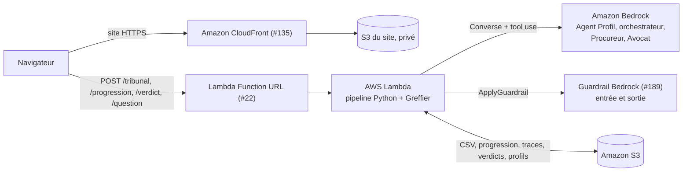

| Service | Rôle | Pourquoi |
|---|---|---|
| **Amazon Bedrock** | Le LLM des quatre agents, région `us-east-1` | Cœur agentique ; le LLM explique, il ne calcule jamais. Profil d'inférence global depuis #150 ([fiche 150](journal/150-profil-inference-global.md)) ; les procès enregistrés de l'interface ont été tenus avec `us.anthropic.claude-sonnet-5-5` ([`index.json`](../frontend/src/data/proces/index.json)) |
| **Guardrail Amazon Bedrock** | Second regard sur le cadre « simulation seulement » (#189) : attaque de consigne à l'entrée, conseil personnalisé à la sortie | Le contrôle Python du Greffier reste la règle ; le Guardrail ajoute un contrôle managé, compté dans le contrôle `cadre_simulation` et dans le champ `bedrock` ([fiche 186](journal/189-agents-coordonnes.md)) |
| **AWS Lambda** | Exécute tout le pipeline : phases, outils, Greffier | Le même code qu'en local (`SOURCE_DONNEES=local\|s3`) |
| **Lambda Function URL** | Point d'accès HTTPS de l'interface | **Choix de #22** : API Gateway coupe à 29 s ; le procès le plus long mesuré a pris 37,4 s ([fiche 022](journal/022-pieges-aws.md)). La Lambda a un délai de 300 s |
| **Amazon S3** | Données, progression du procès en cours, traces, verdicts, profils créés | Chaque procès est archivé avec ses pièces et peut être relu ; la jurisprudence relit les verdicts |
| **Amazon CloudFront** | Sert l'interface en HTTPS depuis un bucket privé (#135) | Adresse publique sans serveur ; les appels au Tribunal ne passent pas par CloudFront, dont le délai vers l'origine est de 60 s au plus ([fiche 135](journal/135-interface-hebergee.md)) |

**Sécurité et coûts** : aucune clé dans le code ni dans Git, rôle IAM minimal ([`politique_iam_lambda.json`](../deploiement/politique_iam_lambda.json)), concurrence réservée de 2, CORS limité à l'interface, débit limité par adresse IP, alerte de budget. Paramètres vérifiés : [`deploiement/README.md`](../deploiement/README.md) ; détails : [`architecture.md`](architecture.md), « Sécurité et coûts ».

### Preuves du déploiement (captures de la console AWS, 2026-11-15)

Les ressources AWS seront supprimées après l'événement : ces captures, prises sur le compte du Datathon, montrent la solution déployée.

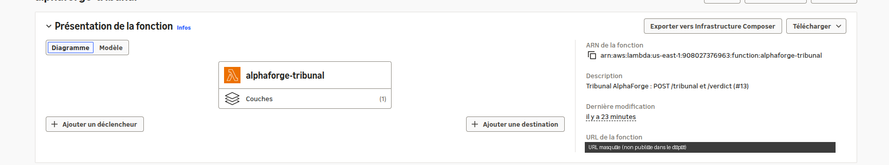
*Figure 10.1 : la fonction Lambda `alphaforge-tribunal` (us-east-1), avec sa couche gérée (pandas) et sa Function URL. L'adresse est masquée : elle n'est pas publiée dans le dépôt.*

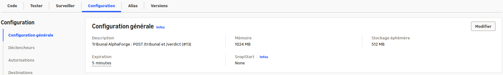
*Figure 10.2 : mémoire de 1024 Mo et délai de 5 minutes (300 s). Les valeurs par défaut (128 Mo, 3 s) ne suffisent pas : un procès dure de 20 à 50 s ([fiche 022](journal/022-pieges-aws.md)).*

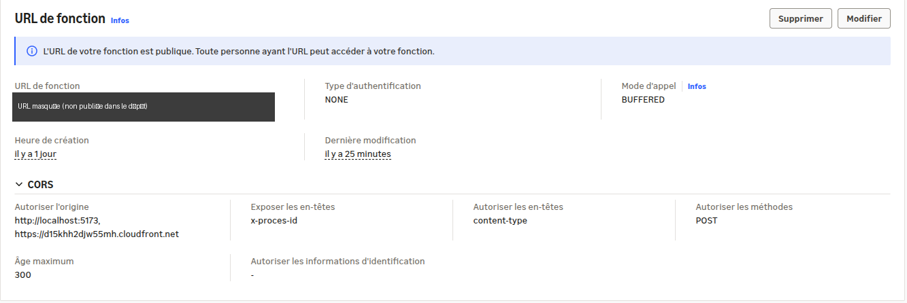
*Figure 10.3 : la Function URL, point d'accès de l'interface (choix de #22 : pas de coupure à 29 s comme API Gateway). CORS limité à `http://localhost:5173` et au site CloudFront, méthode `POST` seulement, en-tête `x-proces-id` exposé pour `/verdict`.*

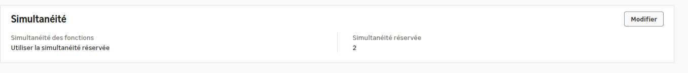
*Figure 10.4 : simultanéité réservée de 2. Le point d'accès est public et chaque procès appelle Bedrock (payant) : au plus deux exécutions à la fois, un 3ᵉ procès reçoit 429 (« Tribunal occupé ») au lieu d'un coût de plus.*

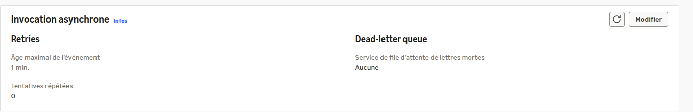
*Figure 10.5 : la progression en direct (#90) lance le procès en arrière-plan par une invocation asynchrone de la Lambda elle-même. Aucune relance automatique (0 tentative) : un procès raté serait refait et refacturé ; un procès qui ne démarre pas en 1 min est abandonné.*

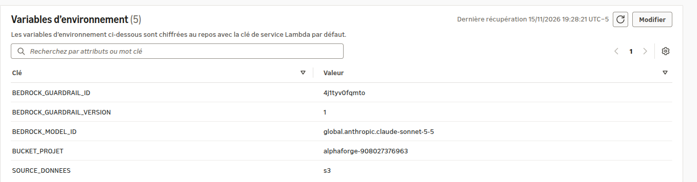
*Figure 10.6 : la configuration de la Lambda tient en cinq variables : le profil d'inférence global de Bedrock, le Guardrail et sa version, le bucket et la source des données (`s3`, contre `local` sur un poste). Aucune clé d'accès : les droits viennent du rôle IAM de la fonction.*

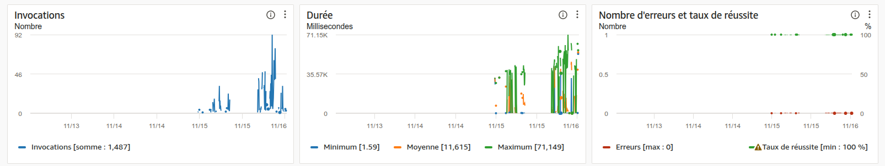
*Figure 10.7 : métriques CloudWatch de la Lambda, du 13 au 16 novembre 2026. 1 487 invocations (procès, questions, profils, et chaque relecture de `/progression` toutes les 1,5 s), aucune erreur, taux de réussite minimal de 100 %. Durée moyenne de 11,6 s (tirée vers le bas par les relectures, rapides) et maximale de 71,1 s : un procès complet avec répliques dépasserait les 29 s d'API Gateway, d'où la Function URL.*

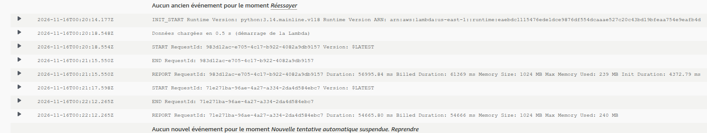
*Figure 10.8 : journal CloudWatch de la Lambda, deux procès du 16 novembre 2026 (UTC). Runtime `python3.14` ; données lues dans S3 en 0,5 s au démarrage ; procès de 57,0 s et 54,7 s ; 239 et 240 Mo utilisés sur 1024 Mo.*

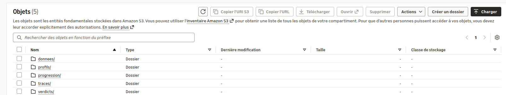
*Figure 10.9 : le bucket du projet. `donnees/` : les CSV lus par la Lambda ; `traces/` : chaque procès archivé avec ses pièces et sa trace ; `progression/` : l'étape en cours, relue par l'interface (#90) ; `verdicts/` : les choix de l'utilisateur, relus par la jurisprudence (#56) ; `profils/` : les Pactes créés au questionnaire (#87).*

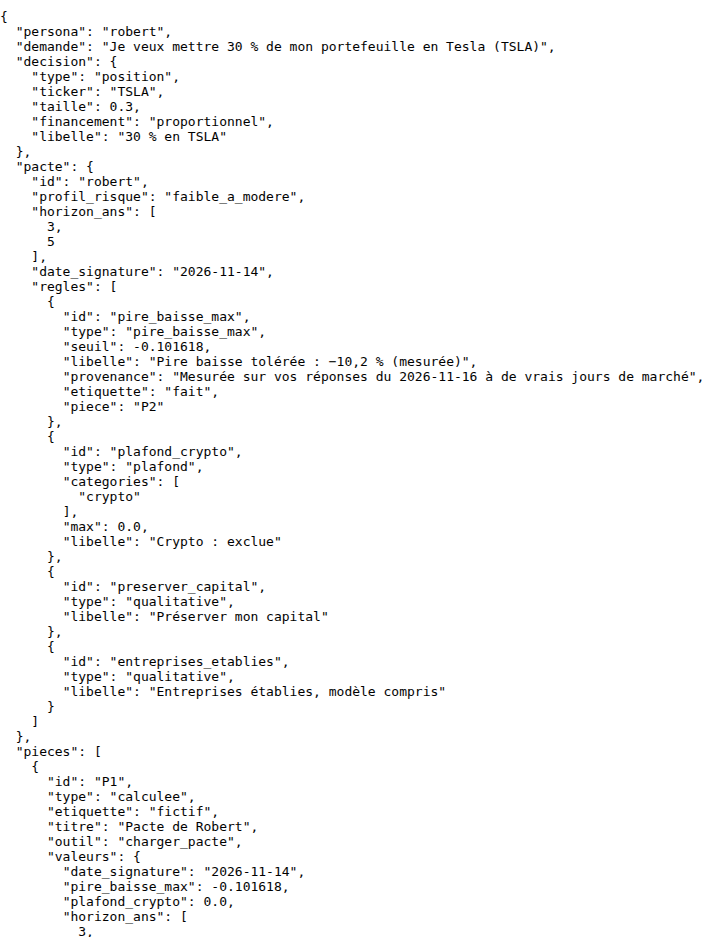
*Figure 10.10 : début d'un procès archivé dans `traces/2026-11-16/` (contrat de la section 5 de [`CLAUDE.md`](../CLAUDE.md)). Profil de test prudent, « 30 % en TSLA ». La règle de pire baisse porte le seuil mesuré par le Pacte vécu (−10,2 %), avec sa provenance et la pièce `P2` qui le prouve.*

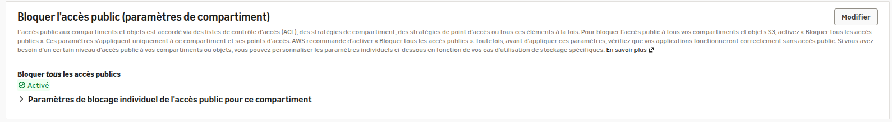
*Figure 10.11 : le bucket `alphaforge-site-<compte>`, qui contient l'interface, bloque tout accès public. Seule la distribution CloudFront peut le lire (#135).*

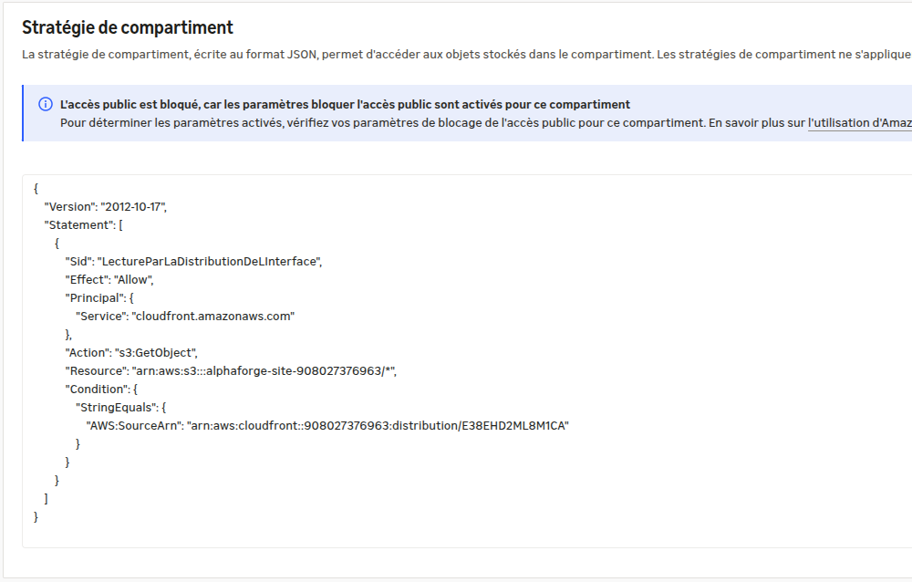
*Figure 10.12 : la stratégie du bucket du site. Une seule autorisation : `s3:GetObject` pour le service CloudFront, à condition que la demande vienne de la distribution de l'interface (`AWS:SourceArn`). Personne d'autre ne lit le bucket, même pas une autre distribution.*

## 11. Le prototype en captures

Le jury ne pourra pas tester le prototype : le compte AWS de l'événement sera supprimé. Chaque écran est donc capturé dans [`preuves/ecrans/`](preuves/ecrans/README.md), en **mode démonstration** : l'interface rejoue des procès **réellement tenus** par les agents Bedrock sur AWS, sans appel réseau. Le script [`frontend/e2e/preuves.mjs`](../frontend/e2e/preuves.mjs) refait toutes les captures (#191).

### Le parcours, écran par écran

| Étape | Capture | Ce qu'elle montre |
|---|---|---|
| Accueil | [`01-accueil`](preuves/ecrans/01-accueil.png) | Choisir un profil de test ou construire son propre Pacte |
| Portefeuille | [`02-robert-portefeuille`](preuves/ecrans/02-robert-portefeuille.png) | Le portefeuille de Robert, son Pacte, la recherche d'un titre |
| Décision | [`03-robert-decision`](preuves/ecrans/03-robert-decision.png) | 30 % en TSLA : zone compatible avec le Pacte et effet sur chaque règle, avant le procès |
| Procès en cours | [`04-robert-proces-en-cours`](preuves/ecrans/04-robert-proces-en-cours.png) | Les phases réelles : Agent Profil, Orchestrateur, Procureur et Avocat, Greffier |
| Tribunal | [`05-robert-tribunal`](preuves/ecrans/05-robert-tribunal.png) | Bilan du Greffier, débats, répliques, instruction, renvoi d'un argument, contre-interrogatoire |
| Contrôles du Greffier | [`06-robert-controles-greffier`](preuves/ecrans/06-robert-controles-greffier.png) | Chaque contrôle sur les arguments, avec son taux mesuré |
| Pièce | [`07-robert-piece-simulation`](preuves/ecrans/07-robert-piece-simulation.png) | Une pièce de simulation : rôle, sources, données vérifiées, limites, calcul |
| Verdict | [`08-robert-verdict`](preuves/ecrans/08-robert-verdict.png) | Maintenir, modifier ou ajuster le Pacte, avec les points de bascule |
| Procès-verbal | [`09-robert-proces-verbal`](preuves/ecrans/09-robert-proces-verbal.png) | Le procès complet, exportable : pièces, débat, contrôles, trace |
| Cas 2 : Amira | [`10`](preuves/ecrans/10-amira-decision-panier.png), [`11`](preuves/ecrans/11-amira-tribunal.png), [`12`](preuves/ecrans/12-amira-verdict.png) | Panier crypto-tech : risque accepté, plafonds de diversification en violation, un point de bascule par règle |
| Cas 3 : Mateo | [`13`](preuves/ecrans/13-mateo-decision.png), [`14`](preuves/ecrans/14-mateo-tribunal.png) | XOM : la controverse ESG documentée, pièce documentaire avec sa source |
| Construire mon Pacte | [`15`](preuves/ecrans/15-construire-pacte-question.png), [`16`](preuves/ecrans/16-construire-pacte-apercu.png) | Le questionnaire, puis le Pacte tiré des réponses |
| Pacte vécu | [`17`](preuves/ecrans/17-pacte-vecu-question.png), [`18`](preuves/ecrans/18-pacte-vecu-resultat.png) | Un vrai jour de baisse revécu ; la limite mesurée sur les réponses |

### Quatre écrans clés

**La décision, avant le procès** : la zone compatible avec le Pacte et l'effet sur chaque règle.

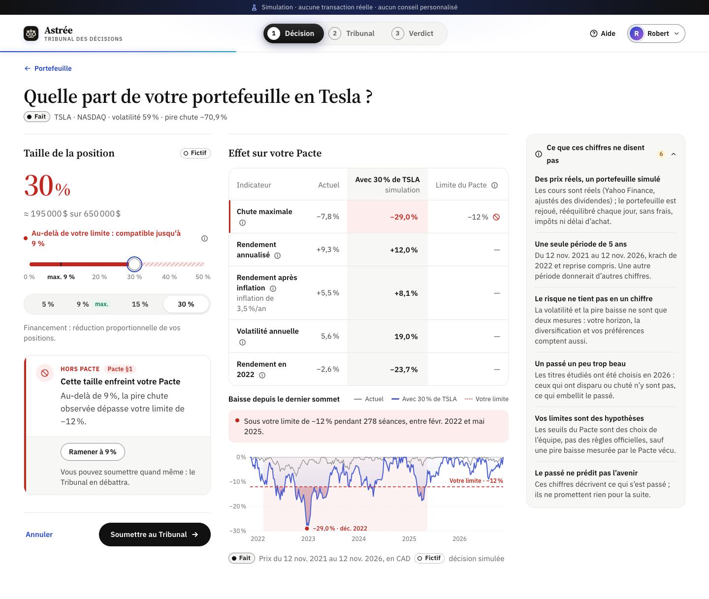

**Les contrôles du Greffier**, chacun avec son taux mesuré quand on a essayé de le tromper.

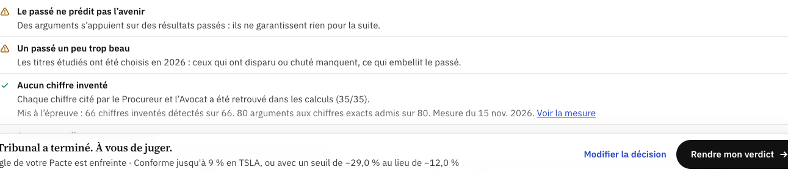

**Une pièce** : d'où viennent les données, comment elles sont vérifiées, ce qu'elles ne disent pas.

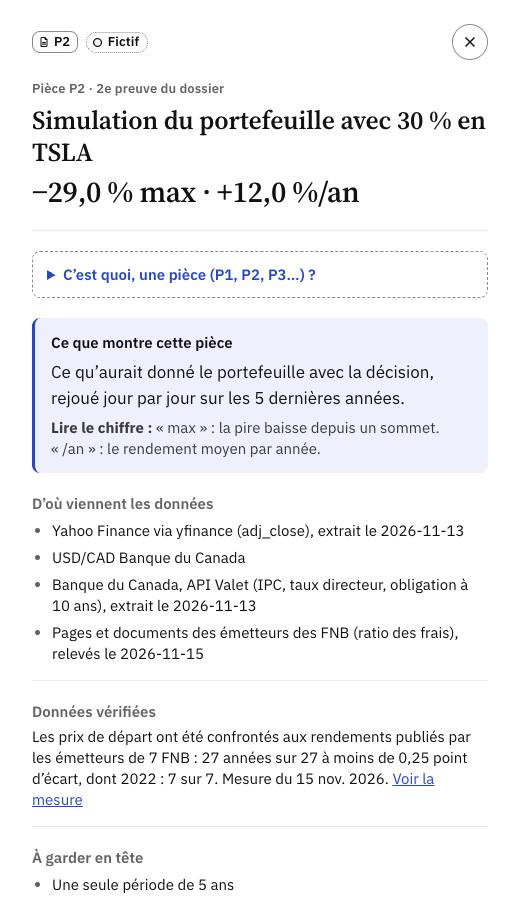

**Le Pacte vécu** : la limite de pire baisse mesurée sur de vrais jours de marché, au lieu d'être déclarée.

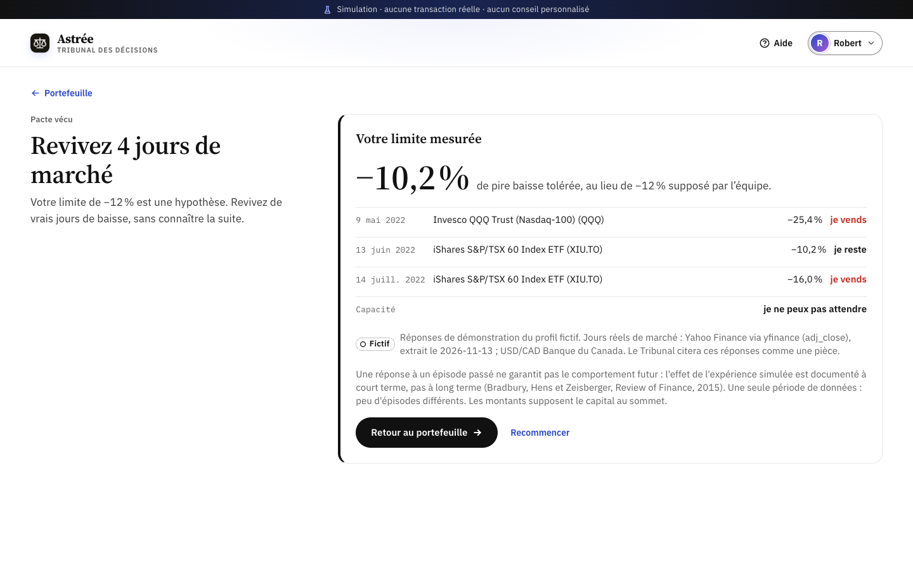
