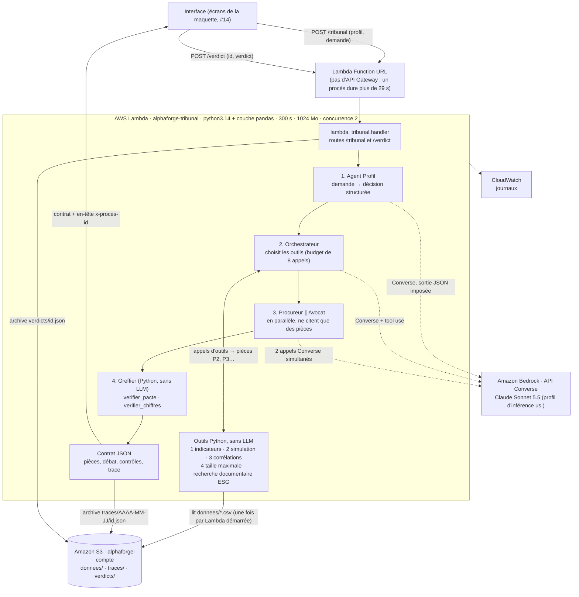

# Architecture AWS du Tribunal

Schéma pour la documentation technique et la vidéo (#13). Le pourquoi de chaque choix est dans [`CHOIX_CONCEPTION.md`](CHOIX_CONCEPTION.md) (choix 4 et 13) ; les paramètres vérifiés, dans [`deploiement/README.md`](../deploiement/README.md).

## Rôle de chaque service

| Service | Ce qu'il fait dans un procès | Pourquoi ce service |
|---|---|---|
| **Amazon Bedrock** | Le LLM des quatre agents : Agent Profil, orchestrateur (boucle Converse avec *tool use*), Procureur et Avocat | Cœur agentique, et la contribution la plus visible d'AWS. Le LLM explique ; il ne calcule jamais |
| **AWS Lambda** | Exécute tout le pipeline : les phases, les outils Python et le Greffier | Même code qu'en local ; aucun serveur à gérer |
| **Lambda Function URL** | Point d'accès HTTPS de l'interface | Un procès dure de 25 à 40 s : API Gateway coupe à 29 s. C'est aussi un service de moins |
| **Amazon S3** | Données (CSV), trace de chaque procès, journal des verdicts | Explicabilité : chaque procès est archivé avec ses pièces et peut être relu |
| **CloudWatch** | Journaux de la Lambda | Diagnostic (ex. : « Données chargées » n'apparaît qu'au démarrage) |

## Un procès, pas à pas

1. L'interface envoie `POST /tribunal` avec l'identifiant du profil et la demande en langage naturel.
2. **Agent Profil** (Bedrock) : charge et valide le Pacte du profil, puis transforme la demande en décision (`position` ou `reallocation`).
3. **Orchestrateur** (Bedrock) : lit la décision et le Pacte, puis **choisit lui-même** les outils Python à appeler, avec une raison courte et sans chiffre pour chacun. Chaque résultat devient une pièce numérotée. La simulation de la décision est ajoutée d'office si le modèle ne l'a pas demandée.
4. **Procureur et Avocat** (Bedrock, en parallèle) : argumentent contre et pour, en citant uniquement les pièces.
5. **Greffier** (Python) : contrôle chaque règle du Pacte et chaque chiffre cité. Un argument non prouvé est renvoyé une fois à son agent, puis rejeté.
6. La Lambda renvoie le contrat JSON et l'archive dans S3. L'utilisateur rend son verdict, qui est archivé par `POST /verdict`.

## Sécurité et coûts

- **Aucune clé** dans le code ni dans Git : le rôle IAM de la Lambda reçoit des identifiants temporaires d'AWS.
- **Rôle IAM minimal** (`deploiement/politique_iam_lambda.json`) : `bedrock:InvokeModel` sur Sonnet 5.5 seulement (profil d'inférence et ses trois régions), et le bucket du projet.
- **Concurrence réservée de 2**, **alerte de budget** de 100 $ par mois, **Function URL en `AWS_IAM`** tant que l'interface n'est pas en ligne. Elle passera ensuite en `NONE` avec un CORS limité au domaine de l'interface (#14), et sera supprimée après le jury.
