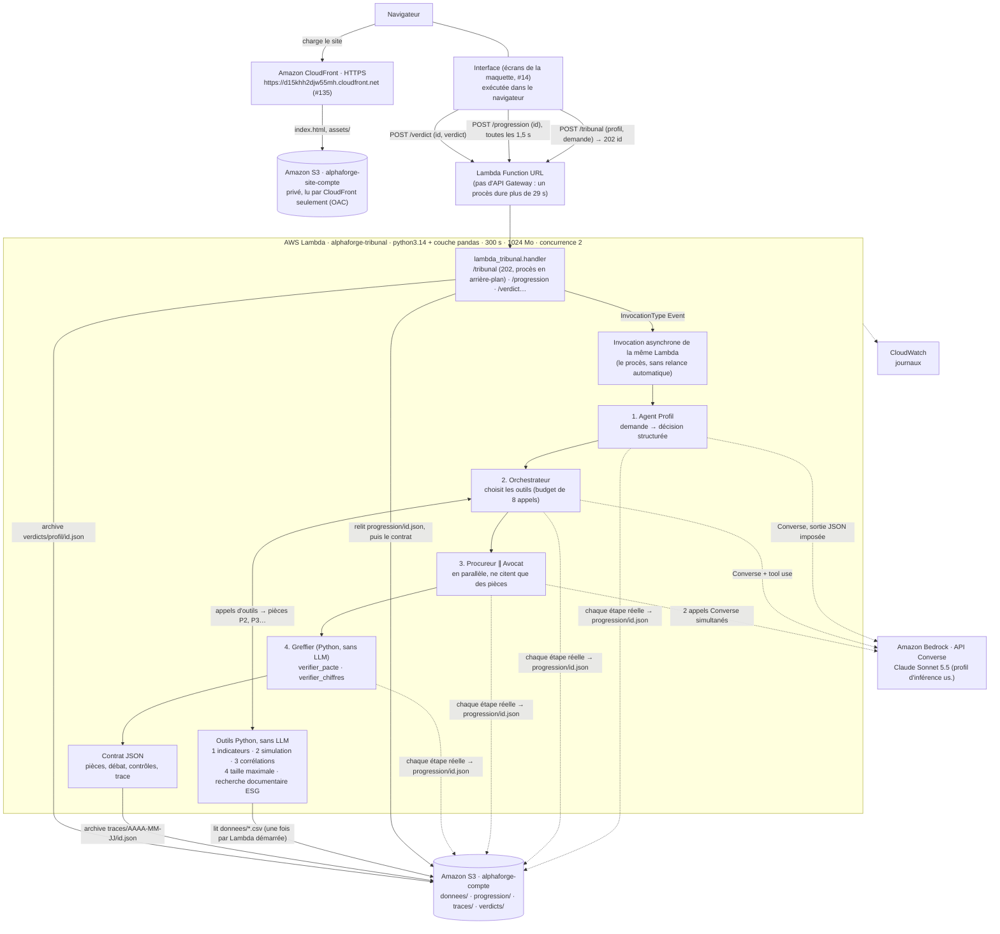

# Architecture AWS du Tribunal

Schéma pour la documentation technique et la vidéo (#13). Le pourquoi de chaque choix est dans [`CHOIX_CONCEPTION.md`](CHOIX_CONCEPTION.md) (choix 4 et 13) ; les paramètres vérifiés, dans [`deploiement/README.md`](../deploiement/README.md).

## Rôle de chaque service

| Service | Ce qu'il fait dans un procès | Pourquoi ce service |
|---|---|---|
| **Amazon Bedrock** | Le LLM des quatre agents : Agent Profil, orchestrateur (boucle Converse avec *tool use*), Procureur et Avocat | Cœur agentique, et la contribution la plus visible d'AWS. Le LLM explique ; il ne calcule jamais |
| **AWS Lambda** | Exécute tout le pipeline : les phases, les outils Python et le Greffier | Même code qu'en local ; aucun serveur à gérer |
| **Lambda Function URL** | Point d'accès HTTPS de l'interface | Un procès dure de 25 à 40 s : API Gateway coupe à 29 s. C'est aussi un service de moins |
| **Amazon S3** | Données (CSV), progression du procès en cours, trace de chaque procès, journal des verdicts | Explicabilité : chaque procès est archivé avec ses pièces et peut être relu ; l'orchestrateur relit les verdicts passés du profil (jurisprudence, #56) ; pendant le procès, l'interface relit chaque étape réelle (#90) |
| **CloudWatch** | Journaux de la Lambda | Diagnostic (ex. : « Données chargées » n'apparaît qu'au démarrage) |
| **Amazon CloudFront** + bucket S3 du site | Sert l'interface en HTTPS (#135) ; le navigateur appelle ensuite la Function URL directement | Adresse publique pour le jury, sans serveur. Bucket privé, lu par la distribution seulement. Les appels au Tribunal ne passent pas par CloudFront : son délai vers l'origine (60 s au plus) couperait les procès longs |

## Un procès, pas à pas

1. L'interface envoie `POST /tribunal` avec l'identifiant du profil et la demande en langage naturel. La Lambda vérifie la demande, répond tout de suite 202 avec l'identifiant du procès, et s'invoque elle-même en asynchrone pour le faire (#90). Pendant les étapes 2 à 5, chaque étape réelle est publiée dans `progression/<id>.json`, que l'interface relit toutes les 1,5 s (`POST /progression`) : elle montre la phase en cours et chaque outil choisi par l'orchestrateur, au moment où il est appelé.
2. **Agent Profil** (Bedrock) : charge et valide le Pacte du profil, puis transforme la demande en décision (`position` ou `reallocation`).
3. **Orchestrateur** (Bedrock) : lit la décision et le Pacte, puis **choisit lui-même** les outils Python à appeler, avec une raison courte et sans chiffre pour chacun. Chaque résultat devient une pièce numérotée. La simulation de la décision est ajoutée d'office si le modèle ne l'a pas demandée.
4. **Procureur et Avocat** (Bedrock, en parallèle) : argumentent contre et pour, en citant uniquement les pièces.
5. **Greffier** (Python) : contrôle chaque règle du Pacte et chaque chiffre cité. Un argument non prouvé est renvoyé une fois à son agent, puis rejeté.
6. La Lambda archive le contrat JSON dans S3 ; la relecture suivante de l'interface le reçoit. L'utilisateur rend son verdict, qui est archivé par `POST /verdict`.

## Sécurité et coûts

- **Aucune clé** dans le code ni dans Git : le rôle IAM de la Lambda reçoit des identifiants temporaires d'AWS.
- **Rôle IAM minimal** (`deploiement/politique_iam_lambda.json`) : `bedrock:InvokeModel` sur Sonnet 5.5 seulement (profil d'inférence et ses trois régions), le bucket du projet, et l'invocation de la fonction elle-même (procès en arrière-plan, #90).
- **Concurrence réservée de 2**, **alerte de budget** de 100 $ par mois, **Function URL en `NONE`** depuis #14, pour que le navigateur l'appelle, avec un CORS limité à l'interface (`http://localhost:5173` et le domaine CloudFront du site, lu sur le compte à chaque déploiement, #136). Elle sera supprimée après le jury.
- **Débit limité par adresse IP** (#136) : l'adresse de la Function URL est lisible dans le JavaScript du site. `/tribunal` (3 par minute) et `/question` (10 par minute) déclenchent Bedrock : au-delà, 429 avant tout appel. Hypothèses de l'équipe, en mémoire de chaque instance de la Lambda.
- **Site hébergé** (#135) : bucket `alphaforge-site-<compte>` à accès public bloqué, lu par la distribution seulement (OAC et condition `AWS:SourceArn`), séparé du bucket des données.
