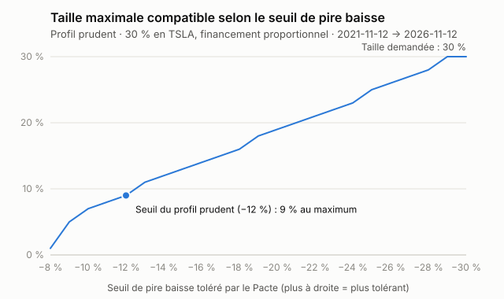

# Résultats des scénarios de validation et de sensibilité

Fichier généré par `python -m validation` (issue #15) : ne pas le modifier à la main.
Partie calculée du procès (Pacte, simulation, Greffier, taille maximale) sur les données du dépôt,
sans appel à Bedrock ; garde-fous de l'orchestrateur joués avec un faux modèle et les vrais outils.

**Bilan : 50 réussis, 0 en échec, 0 en attente.**

## 1. Même décision, profils différents

| Scénario | Attendu | Obtenu | |
|---|---|---|---|
| Profil prudent + 30 % TSLA | violation de pire_baisse_max (seuil −12 %) | violations : pire_baisse_max ; pire baisse −29,0 % ; taille max 9,0 % | ✅ |
| Profil audacieux + 30 % TSLA | aucune violation (environ −42,6 % pour un seuil de −45 %) | aucune violation ; pire baisse −42,6 % ; taille max 30,0 % | ✅ |
| Profil ESG + 30 % TSLA | violation de pire_baisse_max (seuil −20 %) | violations : pire_baisse_max ; pire baisse −33,3 % ; taille max 11,0 % | ✅ |
| Profil ESG + 10 % XOM | aucune violation financière ; règle ESG à vérifier (source manquante) | aucune violation ; pire baisse −10,0 % ; taille max 10,0 % ; controverses_esg : a_verifier | ✅ |
| Profil audacieux + panier crypto-tech (100 % réalloué) | 3 violations : pire baisse, crypto et tech + crypto | violations : pire_baisse_max, plafond_crypto, pas_exclusivement_tech ; pire baisse −61,9 % ; taille max 28,0 % | ✅ |

## 2. Changer un seuil (profil prudent, 30 % TSLA)

| Scénario | Attendu | Obtenu | |
|---|---|---|---|
| Seuil −10,0 % | violation | violation ; taille max 7,0 % | ✅ |
| Seuil −12,0 % | violation | violation ; taille max 9,0 % | ✅ |
| Seuil −15,0 % | violation | violation ; taille max 13,0 % | ✅ |
| Seuil −20,0 % | violation | violation ; taille max 19,0 % | ✅ |
| Seuil −25,0 % | violation | violation ; taille max 25,0 % | ✅ |
| Seuil −30,0 % | conforme | conforme ; taille max 30,0 % | ✅ |
| Taille max quand le seuil s'assouplit | croît (ou reste égale) | 7,0 % → 9,0 % → 13,0 % → 19,0 % → 25,0 % → 30,0 % | ✅ |

## 3. Changer une hypothèse

| Scénario | Attendu | Obtenu | |
|---|---|---|---|
| Profil audacieux + 30 % NVDA, plafond tech + crypto 50,0 % | violation | Technologie et cryptoactifs : 65,0 % du portefeuille après la décision, au-delà du plafond de 50,0 % ; taille max 0,0 % | ✅ |
| Profil audacieux + 30 % NVDA, plafond tech + crypto 60,0 % | violation | Technologie et cryptoactifs : 65,0 % du portefeuille après la décision, au-delà du plafond de 60,0 % ; taille max 20,0 % | ✅ |
| Profil audacieux + 30 % NVDA, plafond tech + crypto 65,0 % | conforme | Technologie et cryptoactifs : 65,0 % du portefeuille après la décision, dans la limite du plafond de 65,0 % ; taille max 30,0 % | ✅ |
| Profil audacieux + 30 % NVDA, plafond tech + crypto 75,0 % | conforme | Technologie et cryptoactifs : 65,0 % du portefeuille après la décision, dans la limite du plafond de 75,0 % ; taille max 30,0 % | ✅ |
| Profil audacieux + 30 % NVDA, plafond tech + crypto 90,0 % | conforme | Technologie et cryptoactifs : 65,0 % du portefeuille après la décision, dans la limite du plafond de 90,0 % ; taille max 30,0 % | ✅ |
| QQQ retiré de la catégorie tech (profil audacieux + 30 % NVDA) | part tech + crypto en baisse de la part de QQQ ; toujours conforme | avant : Technologie et cryptoactifs : 65,0 % du portefeuille après la décision, dans la limite du plafond de 75,0 % \| après : Technologie et cryptoactifs : 51,0 % du portefeuille après la décision, dans la limite du plafond de 75,0 % | ✅ |
| TSLA ajouté à la catégorie tech (profil audacieux + 60 % TSLA) | conforme sans TSLA en tech ; violation avec | avant : conforme (Technologie et cryptoactifs : 20,0 % du portefeuille après la décision, dans la limite du plafond de 75,0 %) \| après : violation (Technologie et cryptoactifs : 80,0 % du portefeuille après la décision, au-delà du plafond de 75,0 %) | ✅ |

## 4. Changer la période (profil prudent, 30 % TSLA)

| Scénario | Attendu | Obtenu | |
|---|---|---|---|
| Portefeuille actuel : pire baisse | identique : la pire baisse de la période est atteinte en 2022 | période complète −7,8 % ; 2022 seule −7,8 % | ✅ |
| Portefeuille actuel : volatilité annualisée | plus élevée en 2022 (année de crise) | période complète 5,6 % ; 2022 seule 6,3 % | ✅ |
| Portefeuille après la décision : pire baisse | identique : la pire baisse de la période est atteinte en 2022 | période complète −29,0 % ; 2022 seule −29,0 % | ✅ |
| Portefeuille après la décision : volatilité annualisée | plus élevée en 2022 (année de crise) | période complète 19,0 % ; 2022 seule 21,7 % | ✅ |

## 5. Robustesse du Greffier (verifier_chiffres et cadre_simulation)

| Scénario | Attendu | Obtenu | |
|---|---|---|---|
| Argument d'origine : « La pire chute observée passe de −7,8 % à −29,0 %. » (P1) | accepté | accepté | ✅ |
| Chiffre inventé : « La pire chute observée passe de −7,8 % à −31,0 %. » (P1) | rejeté | rejeté : « −31,0 % » introuvable dans P1 | ✅ |
| Arrondi faux : « La pire chute observée passe de −7,8 % à −29,03 %. » (P1) | rejeté | rejeté : « −29,03 % » introuvable dans P1 | ✅ |
| Mauvaise pièce citée : « La pire chute observée passe de −7,8 % à −29,0 %. » (P3) | rejeté | rejeté : « −7,8 % » introuvable dans P3 (présent dans P1, pièce non citée) ; « −29,0 % » introuvable dans P3 (présent dans P1, P6, pièce non citée) | ✅ |
| Signe manquant : « Si 2022 se répétait, le portefeuille ferait 2,6 %. » (P2) | rejeté | rejeté : « 2,6 % » introuvable dans P2 : valeur négative, écrire le signe « − » | ✅ |
| Nombre dérivé : « La pire chute serait 21 points de plus qu'aujourd'hui. » (P1) | rejeté | rejeté : « 21 » introuvable dans P1 | ✅ |
| Conseil personnalisé : « La pire chute passe à −29,0 % : vous devriez vendre TSLA. » (P1) | rejeté | rejeté : Conseil personnalisé : « vous devriez » (le Tribunal ne recommande aucune transaction : exposer ce que montrent les pièces et laisser l'utilisateur décider) | ✅ |
| Impératif : « Limitez TSLA : la pire chute passe de −7,8 % à −29,0 %. » (P1) | rejeté | rejeté : Conseil personnalisé : « Limitez » (le Tribunal ne recommande aucune transaction : exposer ce que montrent les pièces et laisser l'utilisateur décider) | ✅ |
| Promesse : « Le rendement annualisé de +12,0 % va continuer à progresser. » (P1) | rejeté | rejeté : Promesse ou prévision sur l'avenir : « va continuer à progresser » (le passé ne prédit pas l'avenir : décrire ce que montrent les pièces, ou un scénario au conditionnel avec l'étiquette « hypothese ») | ✅ |
| Prévision au futur : « Avec 30 % en TSLA, la pire chute de −29,0 % se répétera. » (P1) | rejeté | rejeté : Promesse ou prévision sur l'avenir : « répétera » (le passé ne prédit pas l'avenir : décrire ce que montrent les pièces, ou un scénario au conditionnel avec l'étiquette « hypothese ») | ✅ |
| Promesse niée : « Le rendement annualisé passe à +12,0 %, mais le passé ne prédit pas l'avenir. » (P1) | accepté | accepté | ✅ |
| Citation du Pacte : « Vous avez écrit : « Préserver mon capital ». » (P3) | accepté | accepté | ✅ |

## 6. Garde-fous de l'orchestrateur

| Scénario | Attendu | Obtenu | |
|---|---|---|---|
| Le modèle demande 10 outils | 8 appels au maximum | 8 appels exécutés | ✅ |
| Le modèle oublie la simulation de la décision | simulation ajoutée d'office par Python | 1 pièce ajoutée d'office (P3) | ✅ |
| Le modèle appelle un outil du Greffier | refusé (hors liste blanche) | Erreur : Outil « verifier_chiffres » non autorisé | ✅ |
| Le modèle écrit un chiffre dans sa raison | refusé (raison sans chiffre) | Erreur : La raison ne doit contenir aucun chiffre | ✅ |

## 7. Profil inventé (4e Pacte, un seul fichier JSON)

| Scénario | Attendu | Obtenu | |
|---|---|---|---|
| 25 % NVDA financés depuis SPY | un contrôle par règle ; plafond tech (20 %) en violation | violations : pire_baisse_max, plafond_tech ; pire baisse −27,9 % ; taille max 19,0 % ; pire_baisse_max : violation, plafond_tech : violation, sans_crypto : conforme, local : a_verifier | ✅ |

## 9. Pacte vécu (profil prudent, 30 % TSLA)

| Scénario | Attendu | Obtenu | |
|---|---|---|---|
| Reste jusqu'à 0,0 % | seuil du Pacte conservé | seuil −12,0 % | ✅ |
| Reste jusqu'à −8,0 % | seuil ≥ −8,0 % ; violation | seuil −5,4 % en 3 questions ; violation | ✅ |
| Reste jusqu'à −12,0 % | seuil ≥ −12,0 % ; violation | seuil −10,2 % en 3 questions ; violation | ✅ |
| Reste jusqu'à −20,0 % | seuil ≥ −20,0 % ; violation | seuil −16,0 % en 4 questions ; violation | ✅ |
| Reste jusqu'à −32,0 % | seuil ≥ −32,0 % ; conforme | seuil −31,4 % en 4 questions ; conforme | ✅ |
| Reste jusqu'à −60,0 % | seuil ≥ −60,0 % ; conforme | seuil −50,5 % en 4 questions ; conforme | ✅ |

## 10. Pouvoir d'achat et taux (profil prudent, 30 % TSLA)

| Scénario | Attendu | Obtenu | |
|---|---|---|---|
| Rendement réel 2022 du portefeuille actuel (relation de Fisher) | (1 + rendement) ÷ (1 + inflation) − 1, plus bas que le rendement en dollars | −2,6 % en dollars, inflation 6,3 %, −8,4 % réel | ✅ |
| Contexte de 2022 : taux directeur de la Banque du Canada | en hausse sur l'année (début < moyenne < fin) | 0,2 % → 4,2 %, moyenne 1,9 % | ✅ |
| Ratio de Sharpe avant et après la décision | plus bas après : rendement plus élevé, mais risque beaucoup plus fort | 1,09 → 0,46 | ✅ |
| Données macro indisponibles (fichier absent du bucket) | la pièce obligatoire reste produite, sans valeurs macro | pièce sans inflation ni ratio de Sharpe | ✅ |

## Graphique : taille maximale compatible selon le seuil

Profil prudent, 30 % en TSLA, financement proportionnel. Chaque point est calculé par `rechercher_taille_max` (#21) avec un seuil de pire baisse différent.

Valeurs du graphique

| Seuil de pire baisse | Taille maximale compatible |
|---|---|
| −8,0 % | 1,0 % |
| −9,0 % | 5,0 % |
| −10,0 % | 7,0 % |
| −11,0 % | 8,0 % |
| −12,0 % | 9,0 % |
| −13,0 % | 11,0 % |
| −14,0 % | 12,0 % |
| −15,0 % | 13,0 % |
| −16,0 % | 14,0 % |
| −17,0 % | 15,0 % |
| −18,0 % | 16,0 % |
| −19,0 % | 18,0 % |
| −20,0 % | 19,0 % |
| −21,0 % | 20,0 % |
| −22,0 % | 21,0 % |
| −23,0 % | 22,0 % |
| −24,0 % | 23,0 % |
| −25,0 % | 25,0 % |
| −26,0 % | 26,0 % |
| −27,0 % | 27,0 % |
| −28,0 % | 28,0 % |
| −29,0 % | 30,0 % |
| −30,0 % | 30,0 % |

